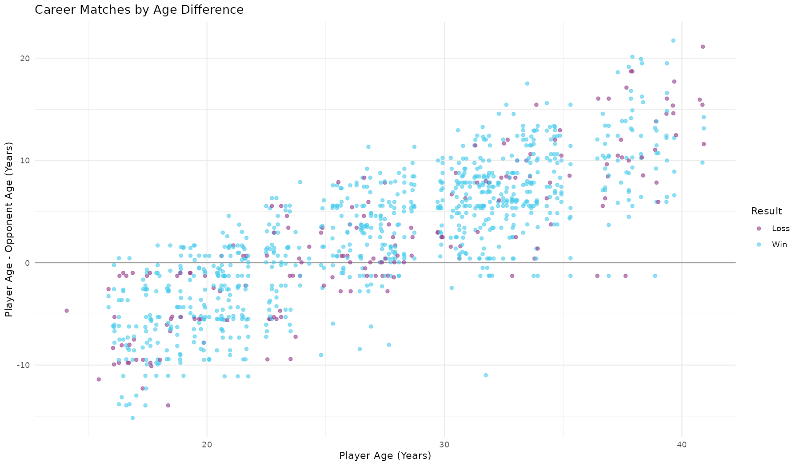

# tennisCareer

An R package for retrieving, cleaning, and visualizing professional tennis players' career match data from [Tennis Abstract](https://www.tennisabstract.com/).

This package was developed for STAT 159 HW3 at UC Berkeley, building on the data processing and visualization work from HW1 and HW2.

## Installation

Install the package directly from GitHub:

```r
devtools::install_github("UCB-stat159-f26/hw03-3-adhkim05")
```

## Usage

The package provides two main functions:

- `get_player_data()` retrieves and processes a player's career match data.
- `plot_player_matches()` creates a scatter plot of player age versus age difference with opponents, colored by match result.

### Serena Williams

```r
library(tennisCareer)

serena <- get_player_data("Serena Williams")
head(serena)

plot_player_matches(serena)
```

### Rafael Nadal

```r
rafa <- get_player_data("Rafael Nadal")
plot_player_matches(rafa)
```

The package handles the different male and female data formats used by Tennis Abstract.

### Invalid Player Names

Invalid player names produce a meaningful error message:

```r
get_player_data("GastonSanchez")
# Error: Could not retrieve data for GastonSanchez
```

## Example Visualization

The following plot was generated using Serena Williams' career match data.



The x-axis represents the player's age, while the y-axis represents the difference between the player's age and the opponent's age. Points are colored by match result (win or loss).

## Testing

The package uses `testthat` for automated testing, including data parsing, cleaning, age calculations, and edge cases. Tests use local fixture data rather than making live requests to Tennis Abstract.

The package successfully passes `R CMD check` with no errors, warnings, or notes.

## Personal Reflections

One of the biggest things I learned from this assignment was the difference between writing code for a specific analysis and developing a reusable package. In HW2, I mainly focused on processing Serena Williams' data and producing a visualization. For HW3, I had to organize that workflow into functions that could work for different players without manually changing the code.

A particularly challenging part was handling the differences between male and female player data. Female players' files contain opponents' dates of birth, while male players' files already contain opponents' ages. This required me to write separate processing logic while keeping the public functions consistent for users.

I also gained experience with automated testing, documentation, and package dependencies. Using `testthat` helped me check edge cases without relying on live requests, while `R CMD check` helped identify issues with documentation, imports, and package structure. Overall, this assignment helped me better understand how to turn an individual data analysis into software that other people can install and reuse.
